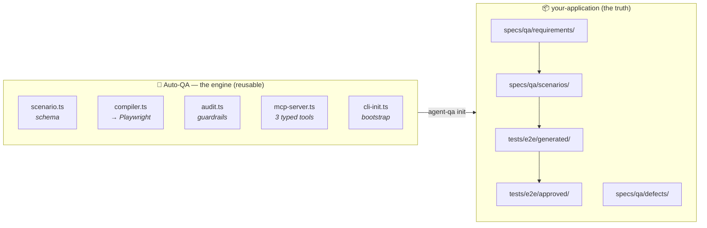

<div align="center">

```
   █████╗ ██╗   ██╗████████╗ ██████╗        ██████╗  █████╗
  ██╔══██╗██║   ██║╚══██╔══╝██╔═══██╗      ██╔═══██╗██╔══██╗
  ███████║██║   ██║   ██║   ██║   ██║█████╗██║   ██║███████║
  ██╔══██║██║   ██║   ██║   ██║   ██║╚════╝██║▄▄ ██║██╔══██║
  ██║  ██║╚██████╔╝   ██║   ╚██████╔╝      ╚██████╔╝██║  ██║
  ╚═╝  ╚═╝ ╚═════╝    ╚═╝    ╚═════╝        ╚══▀▀═╝ ╚═╝  ╚═╝
```

### **An agentic QA engine that writes tests you can actually trust**

*Explores your app like a human · Writes durable Playwright tests · **Proves they catch regressions***

[](https://playwright.dev)
[](https://nodejs.org)
[](https://www.typescriptlang.org)
[](https://modelcontextprotocol.io)
[]()

**[Setup](docs/SETUP.md) · [Agent Playbook](docs/AGENT-PLAYBOOK.md) · [Troubleshooting](docs/TROUBLESHOOTING.md) · [Architecture](docs/PLAN.md)**

Built by **[Ranit Bhowmick](https://ranitbhowmick.com)** · [ranitbhowmick.com](https://ranitbhowmick.com)

</div>

---


## Test like the real world, not like the developer

Read `docs/QA-MINDSET.md` before any exploration; its first section is the
owner's own brief, kept whole. The short of it, which is not a substitute:

- A developer's test passes because it only tries what the system already
  does. Be the outside user instead: real life is messy, full of exceptions,
  uniqueness and noise.
- Required information may simply not exist (no phone, no email, nothing at
  all about the client). Look for the way out; its absence is a finding.
- Steps happen out of order, get skipped, reordered or repeated for one
  exceptional client. Try it.
- People need to undo what they already did. Look for the way back.
- The same system may be used tomorrow by a different business in another
  country with 10,000 customers a day. Ask what breaks.
- Findings are bugs, missing ways out, improvements and new features alike.
- "Works" is not "done". Polish is tested too: if a screen or email is merely
  okay, that is a finding (the owner's bar: no "75% there").

## Why this exists

Letting a model click a button is no longer a product. Playwright ships a
planner, generator and healer. Chrome ships DevTools for agents. That layer is
commodity plumbing now.

The hard part is the thing nobody automates:

> ### 🧠 An agent can observe **what happened**.<br>It cannot know **what should have happened**.

Point a naive agent at your app and it will faithfully encode today's bugs as
tomorrow's passing regression tests — green forever, protecting nothing. That is
strictly worse than having no tests, because it manufactures confidence.

Auto-QA is built around that single problem. Every assertion must name where its
expectation came from, and the machinery makes weak tests *hard to produce*.

---


## 🛡️ How weak tests are prevented

| Failure mode | Defence | Enforced by |
| --- | --- | --- |
| Brittle selectors | The schema **cannot express** XPath, CSS or `nth()` | Type system |
| Sleeps & races | `waitForTimeout` rejected | Static auditor |
| Tautologies | `expect(true).toBe(true)` rejected | Static auditor |
| No oracle | Missing requirement header = audit failure | Static auditor |
| Flaky tests | Must pass repeated clean runs | `repeatEach: 3` |
| **Tests that can never fail** | **Mutate the app, confirm it goes red** | Human/agent step |
| Healer erosion | Assertions may not be deleted or weakened | `AGENTS.md` + audit |

> **Unrepresentable beats discouraged.** A schema that cannot emit an XPath is a
> stronger guarantee than a prompt politely asking an agent not to.

---

## 🏗️ Architecture

**This repository is the engine. It holds no product's tests.**



Each application keeps its **own** requirements, scenarios, tests and evidence,
because those are facts about *that product* and belong under its own review and
history. Dumping every client's tests into the engine would be an unmanageable
sewer.

---

## 📧 Email lab

`npm run email-lab -- <folder-or-files...> [--out dir] [--no-shots]` renders every HTML email at 640, 390 and 320px under four inbox behaviours: as designed, Gmail-style forced dark mode (light backgrounds darkened, images untouched), <style> stripped, and images off. It reports distorted or broken images, images without width and height, page overflow, low contrast, small text and tap targets on phones, and localhost links, and saves a screenshot of every render. A clean report is necessary, not sufficient: look at the screenshots, and hold them to the polish bar above.

## 🧹 UI sweep

`sweeps/ui-sweep.js` runs inside a signed-in page (for example browserd `js.evaluate` with `file:`). It walks every sidebar link and reports misshapen checkboxes, invisible help buttons, raw values in visible text (`null`, `NaN`, `snake_case` keys) and horizontal overflow. Run it after any shared CSS change: one leaked class can break every screen at once.

## ⚡ Quick start

```bash
git clone https://github.com/mljunction/auto-qa.git
cd auto-qa
npm ci
npx playwright install --with-deps chromium
npm run typecheck
```

> Update the clone URL if you host this elsewhere — no remote is configured yet.

**Prove the pipeline works** before pointing it at your own app:

```bash
npm run compile -- specs/scenarios/todo-create.json
npm run audit
```

Expected: `3 passed`, then `{"status": "accepted", "repeatEach": 3}`.

**Prove the guardrails actually bite** — a guardrail that cannot fail is
decoration:

```bash
cat > tests/generated/__probe.spec.ts <<'EOF'
import { test, expect } from '../fixtures.js';
test('probe', async ({ page }) => {
  await page.goto('./');
  await page.waitForTimeout(1000);
  await page.locator('div:nth-child(3) > button').click();
  expect(true).toBe(true);
});
EOF
npx tsx src/cli-audit.ts tests/generated/__probe.spec.ts   # expect exit 1 + 4 issues
rm tests/generated/__probe.spec.ts
```

---

## 🎯 Point it at your application

```bash
npx tsx src/cli-init.ts --target /absolute/path/to/your-app
```

Detects your framework, dev command and port, then scaffolds everything **into
the target repo**. Never overwrites an existing file, so re-running is safe.

```bash
cd /path/to/your-app
npm install --save-dev @playwright/test@1.62.1
npx playwright install chromium
npx playwright test --config=playwright.qa.config.ts tests/e2e/seed.spec.ts --project=chromium
```

**If the seed test fails, stop.** That is the environment, not the feature.

Full walkthrough: **[docs/SETUP.md](docs/SETUP.md)**

---

## 🤖 Copy-paste prompts for AI agents

### Bootstrap a new target repository

```text
Set up Auto-QA for this repository.

1. Clone the engine if it is not already present:
   git clone https://github.com/mljunction/auto-qa.git ../auto-qa
   cd ../auto-qa && npm ci && npx playwright install --with-deps chromium

2. Bootstrap this repo as a QA target:
   npx tsx ../auto-qa/src/cli-init.ts --target .

3. Review the generated agent-qa.config.json. Framework detection is a guess —
   verify baseURL, port and startCommand against how this app actually starts.

4. Install the runner here:
   npm install --save-dev @playwright/test@1.62.1
   npx playwright install chromium

5. Verify the environment:
   npx playwright test --config=playwright.qa.config.ts tests/e2e/seed.spec.ts --project=chromium

Stop and report if the seed test fails. Do not continue past a failing seed.
Report the detected config so I can confirm it before any tests are written.
```

### Generate a test for a feature

```text
Read AGENTS.md, docs/AGENT-PLAYBOOK.md and agent-qa.config.json first.

Test: <feature name>

Requirement source: specs/qa/requirements/<file>.md
(If no requirement document exists, STOP and tell me. Do not infer expected
behaviour from what the screen currently shows.)

Steps:
1. Run the seed test. Stop if it fails.
2. Explore with Playwright MCP using accessibility snapshots, not screenshots.
3. Record actions, semantic locators, console errors and network activity.
4. For each candidate assertion answer: what requirement supports this, and
   could this assertion pass while the feature is broken?
5. Write specs/qa/scenarios/<id>.json naming its requirementSource.
6. Compile with qa_compile_scenario.
7. Validate with qa_validate_generated_tests (repeatEach: 3, project: chromium).
8. MUTATION CHECK: break the behaviour, confirm the test FAILS, revert,
   confirm it PASSES, confirm git status is clean.

Rules: no waitForTimeout, no CSS/XPath/nth() selectors, no test.skip, no
weakened assertions. Scope duplicated names with `within`, never .first().

If the app contradicts the requirement, write specs/qa/defects/<slug>.md and
report a defect. Do NOT rewrite the assertion to match the defect.

Report the mutation-check result explicitly.
```

### Repair a failing test

```text
Test <path> is failing. Read docs/AGENT-PLAYBOOK.md phase 8 first.

Classify the failure BEFORE editing anything:
application defect | requirement ambiguity | fixture failure | environment
failure | locator drift | synchronization failure | invalid assertion |
genuine requirement change

You may repair: locators, setup, real synchronization problems.
You may NOT: delete or weaken assertions, add test.skip, replace expected
values with current output, or raise timeouts without evidence.

If behaviour contradicts the requirement, that is an application defect — file
it, do not touch the test.

Report whether any assertion changed.
```

---

## 📚 Documentation

| Document | What it covers |
| --- | --- |
| 🚀 **[docs/SETUP.md](docs/SETUP.md)** | Every verified command, engine and target — plus the failures hit during bring-up |
| 🤖 **[docs/AGENT-PLAYBOOK.md](docs/AGENT-PLAYBOOK.md)** | 9-phase procedure for running a QA session |
| 🔧 **[docs/TROUBLESHOOTING.md](docs/TROUBLESHOOTING.md)** | Real symptoms → real causes |
| 📋 **[AGENTS.md](AGENTS.md)** | Permanent rules for any agent working here |
| 🎭 **[CLAUDE.md](CLAUDE.md)** | Thin Claude Code adapter over `AGENTS.md` |
| 📐 **[.agent/PLANS.md](.agent/PLANS.md)** | What a valid ExecPlan must contain |
| 🏛️ **[docs/PLAN.md](docs/PLAN.md)** | Original architecture rationale |
| 🔌 **[docs/MCP-STRUCTURE.md](docs/MCP-STRUCTURE.md)** | Engine/target split, MCP install, vision, offline tests |

### Skills

Loaded automatically by Claude Code and Codex when a task matches.

| Skill | Path |
| --- | --- |
| `frontend-qa` (Claude) | [.claude/skills/frontend-qa/SKILL.md](.claude/skills/frontend-qa/SKILL.md) |
| `frontend-qa` (Codex) | [.agents/skills/frontend-qa/SKILL.md](.agents/skills/frontend-qa/SKILL.md) |
| ↳ Scenario format | [references/scenario-format.md](.claude/skills/frontend-qa/references/scenario-format.md) |
| ↳ Test quality rules | [references/test-quality-rules.md](.claude/skills/frontend-qa/references/test-quality-rules.md) |
| ↳ Validation script | [scripts/validate-generated-test.sh](.claude/skills/frontend-qa/scripts/validate-generated-test.sh) |

---

## 🔌 MCP tools

Narrow, typed operations — and **no generic shell tool**. Browser-controlled
content reaching a shell is remote code execution.

The server advertises 14 tools. The core of the authoring loop:

| Tool | Purpose |
| --- | --- |
| `qa_compile_scenario` | Validate a scenario → write a permanent test |
| `qa_validate_generated_tests` | Reject weak tests, then run them repeatedly |
| `qa_run_playwright_tests` | Run existing tests without arbitrary commands |
| `qa_promote_tests` | Move a proven test into the approved suite |

Session and discovery tools (`qa_preflight`, `qa_discover_application`,
`qa_check_scope`, `qa_prepare_auth_state`, `qa_begin_session`, `qa_record_event`,
`qa_complete_session`, `qa_session_summary`, `qa_list_generated_tests`,
`qa_config`) round out the set.

Target paths are constrained to the repository. Versions in generated
`.mcp.json` are **pinned**, never `@latest` — an unattended upgrade of the
browser-control layer must not break a product's QA overnight.

| Package | Pinned |
| --- | --- |
| `@playwright/mcp` | `0.0.78` |
| `chrome-devtools-mcp` | `1.6.0` |
| `@playwright/test` | `1.62.1` |

### Browser control servers

Playwright MCP owns browser actions. Two others can sit alongside it:

| Server | Role | Required? |
| --- | --- | --- |
| `@playwright/mcp` | Drives the browser. Accessibility snapshots, clicks, assertions. | Yes |
| [`browserd`](https://github.com/Kawai-Senpai/Browsered) | Records network, console, exceptions and navigations continuously. Also resolves **semantic locators** and records a driven flow as scenario steps. | Optional |
| `chrome-devtools-mcp` | Narrow fallback when Playwright evidence is insufficient. | Optional |

#### What browserd adds to the authoring loop

The scenario schema accepts only `role` + `name`, `label`, `text` and `testId`.
Choosing among those for an element found by selector is otherwise a guess that
only fails at compile time. browserd answers it in the browser:

| Tool | Answers |
| --- | --- |
| `locator.candidates` | Which locators address this element, and how many things does each actually match. When one is ambiguous, which landmark scope makes it unique - the honest alternative to `.first()`. |
| `locator.check` | Does this scenario target resolve to exactly one element, right now. |
| `qa.record_start` / `qa.steps` | The flow you just drove, as scenario steps with semantic targets resolved before each action ran. |
| `qa.evidence` | Which first-party calls fired, what errored, where it ended up - over a window chosen *after* the flow, since recording was always on. |
| `qa.scenario_draft` | The recorded flow in scenario shape, with `assertions: []` and `requirementSource: null`. |

That last one is the point rather than an oversight. **browserd reports what
happened and never decides what should have happened**, so every candidate
assertion carries a null oracle and the draft refuses to call itself compilable
until a requirement is attached. The guarantee this repository exists to make
survives the handoff.

`storage.export { format: "playwright" }` also emits a real `storageState` file
for a scenario's `role`, and `page.snapshot { format: "aria" }` emits Playwright's
aria-snapshot dialect for an `ariaSnapshot` assertion.

One constraint worth knowing before you plan a session: **each server drives its
own browser.** browserd records its own Chromium and its own tool calls, so the
locator and recording tools only see flows that browserd drove. Pick one driver
per flow; a half-recorded flow hides its own gaps.

**browserd is optional.** Without it you lose retrospective evidence and locator
resolution, not the ability to test. The agent may install it when a task needs
that and the tools are absent, with your agreement, because it writes to your
MCP client config:

```bash
git clone https://github.com/Kawai-Senpai/Browsered.git browserd && cd browserd
npm install
npm run build
node scripts/install-mcp.mjs      # merges into detected clients, writes a .bak first
node scripts/verify-mcp.mjs       # real MCP handshake per client
```

Needs Node >= 20.11 and a Chromium (`npx playwright install chromium` if absent).
The installer merges rather than overwrites, so existing servers survive.
**Restart the client afterwards** - a server registered mid-session does not
appear until the session restarts.

The agent-facing version of this lives in the `frontend-qa` skill under
[Browser Control Servers](.claude/skills/frontend-qa/SKILL.md#browser-control-servers).

---

## 🔄 The lifecycle

```
  📖 Requirement          ← the oracle. Without this, stop.
       ↓
  🌱 Seed test            ← environment proven, or stop
       ↓
  🔍 Explore              ← accessibility tree, not pixels
       ↓
  📝 Scenario JSON        ← reviewable, requirement-linked
       ↓
  ⚙️  Compile             ← permanent Playwright TypeScript
       ↓
  🛡️  Static audit        ← brittle patterns rejected
       ↓
  🔁 Repeat ×3            ← flakiness surfaced
       ↓
  💥 Mutation check       ← proves the test can actually fail
       ↓
  ✅ Approved             ← runs in CI with no AI, no MCP
```

> **The agent is the explorer and author. Playwright is the permanent executor.**
> Once the file exists, no model, MCP server or extension is involved.

---

## 🧩 Scripts

| Command | Purpose |
| --- | --- |
| `npm run typecheck` | `tsc --noEmit` |
| `npm run compile -- <scenario.json>` | Compile one scenario |
| `npm run audit [target]` | Static audit + repeated execution |
| `npm run init -- --target <path>` | Bootstrap a target repository |
| `npm run mcp` | Start the QA MCP server on stdio |
| `npm test` | Run the whole Playwright suite |

---

## 📍 Status

**Working:** scenario schema with landmark scoping · compiler · static auditor ·
MCP server · target bootstrap with framework detection · browser evidence
capture · seed verification.

**Not built yet:** exploration recording to `.qa/sessions` · the healer · HAR
replay for offline runs · auth storage-state · visual baselines · automatic
requirement-file validation · PR creation.

Early, but the pipeline is proven end to end against a real application —
including a mutation check that confirmed the generated test fails when the
behaviour it protects is broken.

---

<div align="center">

**Built by [Ranit Bhowmick](https://ranitbhowmick.com)**

[🌐 ranitbhowmick.com](https://ranitbhowmick.com)

<sub>Markdown guides tell an agent what good work looks like.<br/>
Schemas, scripts, permissions and CI are what prevent bad work.</sub>

</div>
